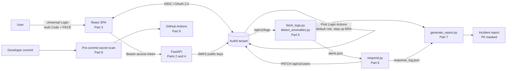

# Auth0 IAM and API Security Lab

An end-to-end identity and access management lab built on Auth0, FastAPI and React. It implements least-privilege role assignment, OAuth 2.0 / OIDC authentication, JWT-based API authorization and step-up MFA, then adds the operational layer around them: log-based anomaly detection, automated containment, incident reporting, secret scanning, a CI security pipeline and a compliance controls mapping.

Each part builds on the previous one and follows the NIST SP 800-61r2 incident response lifecycle.

[](https://github.com/AzaldoMAZ/Auth0-IAM-Security-Lab/actions/workflows/security-pipeline.yml)

---

## Contents

- [Lab overview](#lab-overview)
- [Architecture](#architecture)
- [Technology stack](#technology-stack)
- [Security controls](#security-controls)
- [Detection and response](#detection-and-response)
- [CI security pipeline](#ci-security-pipeline)
- [Compliance mapping](#compliance-mapping)
- [Repository structure](#repository-structure)
- [Getting started](#getting-started)
- [Scope and limitations](#scope-and-limitations)
- [Security notice](#security-notice)

---

## Lab overview

| Part | Component | What it implements | IR lifecycle phase |
|---|---|---|---|
| [1](part-01-default-role-action/README.md) | Default role assignment | Post Login Action assigns a default role via the Management API (M2M app scoped to `read:roles`, `update:users`) | Preparation |
| [2](part-02-fastapi-api/README.md) | Protected FastAPI API | RS256 JWT validation via JWKS; issuer, audience and expiry checks; permission enforcement (`read:protected`) | Preparation |
| [3](part-03-react-auth0-client/README.md) | React SPA client | Universal Login with Authorization Code Flow + PKCE; Bearer token calls to the API | Preparation |
| [4](part-04-step-up-mfa/README.md) | Step-up MFA | `acr_values`-triggered OTP MFA; namespaced MFA claim required for `read:sensitive` | Preparation |
| [5](part-05-audit-logging-anomaly-detection/README.md) | Audit logging and detection | Pulls tenant logs from `/api/v2/logs`; four detections mapped to MITRE ATT&CK | Detection and Analysis |
| [6](part-06-automated-incident-response/README.md) | Automated incident response | Blocks brute-forced accounts via the Management API; other findings routed to manual review | Containment |
| [7](part-07-incident-reporting/README.md) | Incident reporting | Correlates findings and response actions into a Markdown report with automatic PII masking | Post-Incident Activity |
| [8](part-08-secret-scanning-prevention/README.md) | Secret scanning | Git pre-commit hook blocking tokens, keys and PII before they are committed | Preparation (lessons learned) |
| [9](part-09-ci-security-pipeline/README.md) | CI security pipeline | GitHub Actions: repository-wide secret scan and pytest suite for authorization logic | Preparation |
| [10](part-10-compliance-mapping/README.md) | Compliance mapping | Controls crosswalked to NIST CSF 2.0, ISO/IEC 27001:2022 Annex A and CIS Controls v8 | Governance |

---

## Architecture



**Request path (Parts 1–4):** the SPA authenticates the user through Auth0 and requests an access token for the API audience. FastAPI verifies the RS256 signature against Auth0's JWKS endpoint, validates `iss`, `aud` and `exp`, then checks the required permission. The sensitive endpoint also requires the `https://auth0-fastapi-lab/mfa` claim, which a Post Login Action adds only after OTP MFA succeeds.

**Operations path (Parts 5–7):** a Machine-to-Machine client pulls tenant logs, the detection engine writes findings to `alerts.json`, the responder acts on them and logs every decision, and the report generator correlates both outputs into a single incident report.

---

## Technology stack

| Layer | Technologies |
|---|---|
| Identity provider | Auth0 (Universal Login, Actions, RBAC, Management API, Guardian OTP) |
| API | Python, FastAPI, PyJWT / JWKS validation |
| Client | React, Vite, Auth0 React SDK |
| Automation | Python (`requests`, standard library), Auth0 Node.js SDK in Actions |
| CI/CD | GitHub Actions, pytest |
| Frameworks | MITRE ATT&CK, NIST SP 800-61r2, NIST CSF 2.0, ISO/IEC 27001:2022, CIS Controls v8 |

---

## Security controls

**Authentication**
- OAuth 2.0 Authorization Code Flow with PKCE for the browser client
- OIDC user identity via Auth0 Universal Login
- Step-up OTP MFA requested through `acr_values`, with `allowRememberBrowser: false`

**Authorization**
- RS256 JWT verification using Auth0's JWKS endpoint
- Issuer, audience and expiration validation on every request
- Permission-based access per endpoint (`read:protected`, `read:sensitive`)
- Server-side enforcement of a namespaced MFA proof claim
- Explicit `401` (unauthenticated) and `403` (insufficient permission or missing MFA) responses

**Least privilege**
- Default role assigned automatically to users without one
- Each Machine-to-Machine application scoped only to the Management API permissions it needs
- Per-application API access in the Auth0 dashboard

**Secrets and data protection**
- Credentials held in environment variables and Action secrets; `.env.example` templates only
- Raw logs, response logs and generated reports excluded via `.gitignore`
- Pre-commit and CI secret scanning; matches are printed masked, never in full
- Automatic PII masking in incident reports

---

## Detection and response

| Detection | MITRE ATT&CK | Trigger | Automated response |
|---|---|---|---|
| Repeated failed logins | T1110 Brute Force | ≥ 5 failures for one user within 10 minutes | Account blocked via `PATCH /api/v2/users/{id}` |
| Impossible travel | T1078 Valid Accounts | Country change between successful logins within 30 minutes | Alert only, manual review |
| Role or permission change | T1098 Account Manipulation | `sapi` event referencing a role or permission | Alert only, manual review |
| Failed MFA challenge | T1556.006 MFA Interception | `fmfa` or `gd_recovery_failed` event | Alert only, manual review |

Only brute force is contained automatically: it is high-confidence and cheap to reverse. Impossible travel can be caused by a VPN, and a permission change may be legitimate, so those findings stay with a human.

The responder runs in `DRY_RUN=true` mode by default, is idempotent across repeated runs, and writes every action (or deliberate non-action) to an audit log. The full pipeline was verified end to end against a live brute-force attempt on the Part 3 login client.

---

## CI security pipeline

[`.github/workflows/security-pipeline.yml`](.github/workflows/security-pipeline.yml) runs on every push and pull request to `main`:

| Job | Purpose |
|---|---|
| `secret-scan` | Runs the Part 8 scanner against every tracked file (`git ls-files`), catching anything committed with `--no-verify` or without the hook installed |
| `permission-tests` | Runs `test_auth.py` against Part 2's `require_permission()` with constructed token payloads: granted via `permissions`, granted via `scope`, denied, empty token and unrelated permission |

Either job failing fails the pipeline. The tests need no Auth0 credentials or network access.

---

## Compliance mapping

[Part 10](part-10-compliance-mapping/README.md) maps each implemented control to NIST CSF 2.0, ISO/IEC 27001:2022 Annex A and CIS Controls v8, for example:

| Control | NIST CSF 2.0 | ISO 27001 Annex A | CIS v8 |
|---|---|---|---|
| Step-up MFA for sensitive operations | PR.AA-03 | A.8.5 | 6.3, 6.4 |
| Log analysis and anomaly detection | DE.CM-01, DE.CM-03 | A.8.16 | 8.5, 13.1 |
| Automated incident containment | RS.MI-01 | A.5.26 | 17.4, 17.9 |
| Pre-commit secret scanning | PR.DS-01 | A.8.12 | 3.10, 3.11 |

It also includes a gap analysis of areas the lab does not cover.

---

## Repository structure

```text
.
├── .github/workflows/
│   └── security-pipeline.yml          # CI: secret scan + permission tests
├── part-01-default-role-action/       # Post Login Action: default role assignment
├── part-02-fastapi-api/               # FastAPI resource server, JWT validation
├── part-03-react-auth0-client/        # React SPA, Auth Code + PKCE
├── part-04-step-up-mfa/               # Step-up MFA Action and sensitive endpoint
├── part-05-audit-logging-anomaly-detection/
│   ├── fetch_logs.py                  # Pulls tenant logs via Management API
│   └── detect_anomalies.py            # Four ATT&CK-mapped detections
├── part-06-automated-incident-response/
│   └── respond.py                     # Containment, alerting, audit log
├── part-07-incident-reporting/
│   └── generate_report.py             # Markdown incident report, PII masking
├── part-08-secret-scanning-prevention/
│   ├── scan_secrets.py                # Secret and PII scanner
│   └── install_hook.py                # Installs git pre-commit hook
├── part-09-ci-security-pipeline/
│   └── test_auth.py                   # pytest suite for authorization logic
└── part-10-compliance-mapping/        # NIST CSF, ISO 27001, CIS v8 crosswalk
```

Each part contains its own README with setup steps and an `evidence/` folder of redacted screenshots.

---

## Getting started

**Prerequisites:** an Auth0 tenant, Python 3.10+, Node.js 18+.

```bash
git clone https://github.com/AzaldoMAZ/Auth0-IAM-Security-Lab.git
cd Auth0-IAM-Security-Lab

# Install the secret-scanning pre-commit hook
python part-08-secret-scanning-prevention/install_hook.py

# API (Part 2)
cd part-02-fastapi-api
cp .env.example .env            # add your Auth0 domain and API audience
pip install -r requirements.txt
uvicorn main:app --reload

# Client (Part 3), in a second terminal
cd part-03-react-auth0-client
cp .env.example .env            # add your SPA client ID and audience
npm install
npm run dev
```

Parts 5–7 run in order (`fetch_logs.py` → `detect_anomalies.py` → `respond.py` → `generate_report.py`) using a Machine-to-Machine application with `read:logs`, `read:logs_users`, `read:users` and `update:users`. See each part's README for its Auth0 configuration.

Run the authorization tests locally:

```bash
cd part-02-fastapi-api
pip install pytest
pytest ../part-09-ci-security-pipeline/test_auth.py -v
```

---

## Scope and limitations

- This is a lab environment, not a production deployment. Controls are implemented but not formally audited.
- Detections are rule-based with fixed thresholds; there is no baselining or tuning against real traffic volumes.
- Only brute force is contained automatically by design.
- Not covered: asset and data inventory, vendor risk assessment of Auth0, backup and recovery, security awareness training and a formal risk register (see the [Part 10 gap analysis](part-10-compliance-mapping/README.md#gap-analysis---what-this-lab-does-not-cover)).

---

## Security notice

Never commit `.env` files, client secrets, passwords, bearer tokens or unredacted log exports. Install the pre-commit hook after cloning. All published evidence has been redacted of email addresses, Auth0 user identifiers, tokens and MFA enrollment QR codes.
